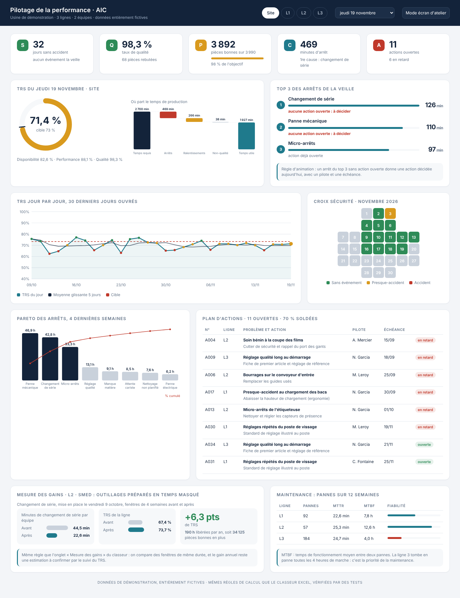
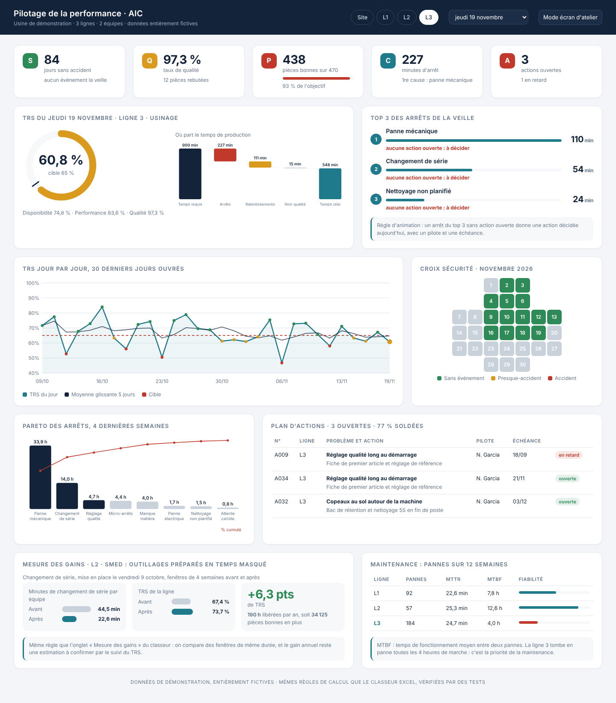
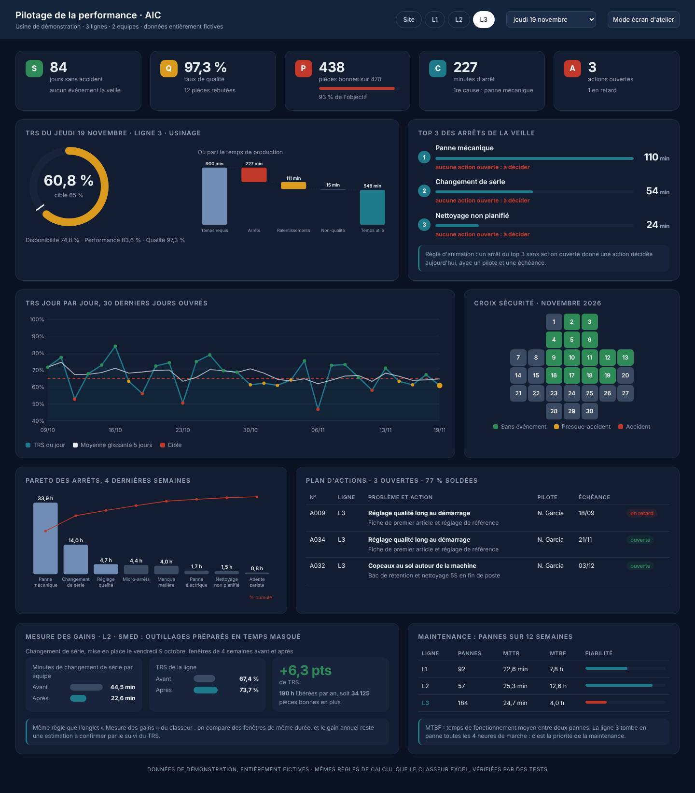
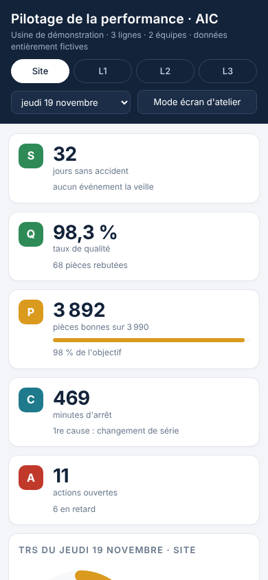
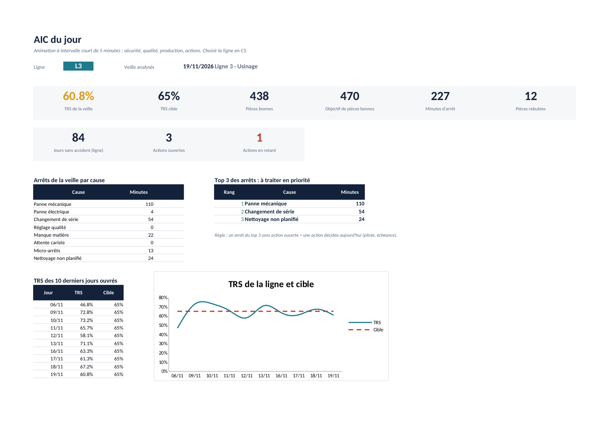
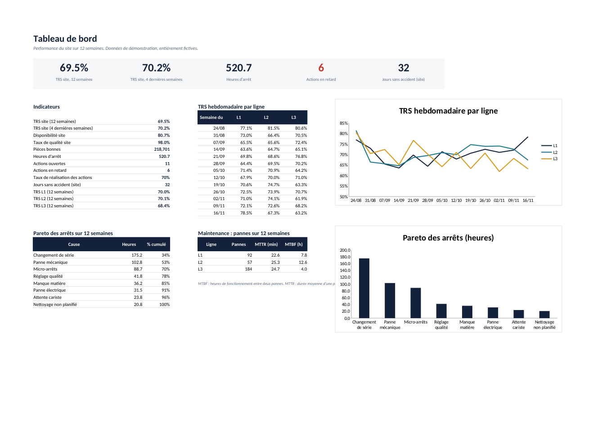
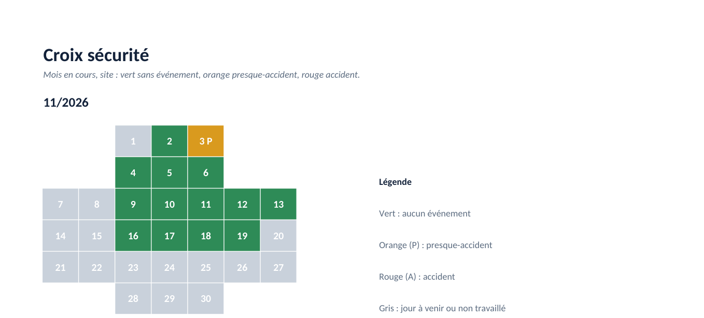
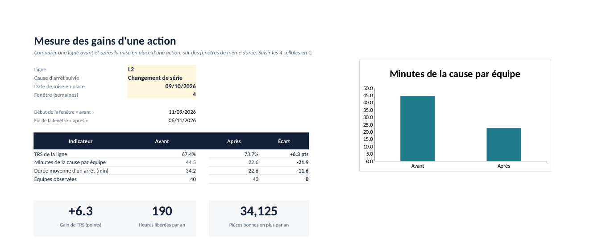
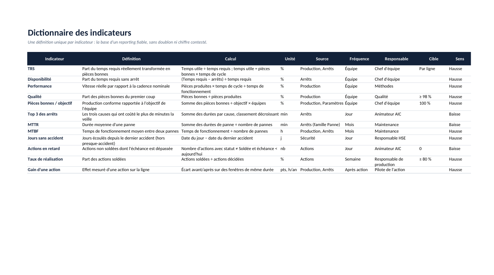
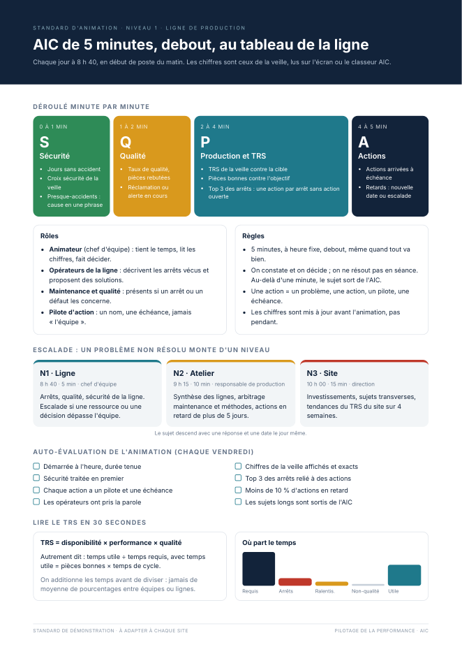

# Pilotage de la performance industrielle et animation à intervalle court (AIC)

[](https://github.com/kawtar-bellamine/aic-performance-cockpit/actions/workflows/tests.yml)

Dans un atelier, la performance se joue chaque matin en 5 minutes, devant le tableau de la ligne : sécurité, qualité,
production, actions. Ce projet construit **tout ce qu'il faut pour une AIC fiable**, à partir des données de production :
le calcul du TRS, l'écran d'animation, le tableau de bord du management, la croix sécurité, le plan d'actions et le
standard d'animation.

| Livrable | Fichier |
|---|---|
| **Classeur Excel de pilotage**, sans macro, prêt à la saisie : AIC du jour, tableau de bord, croix sécurité, mesure des gains, dictionnaire des indicateurs, plan d'actions | [`outputs/pilotage_performance_aic.xlsx`](outputs/pilotage_performance_aic.xlsx) |
| **Écran d'animation web** : vue site ou par ligne, choix du jour, mode écran d'atelier, lisible sur téléphone | [`docs/index.html`](docs/index.html) (GitHub Pages) |
| **Standard d'animation AIC** sur une page A4, à afficher au tableau de chaque ligne | [`outputs/standard_animation_AIC.pdf`](outputs/standard_animation_AIC.pdf) |
| **Kit Power BI** : modèle en étoile en CSV (réutilisable dans Qlik), mesures DAX dont MTBF, MTTR et gains, thème et guide de montage | [`powerbi/`](powerbi/) |

> **Données de démonstration.** L'usine, ses 3 lignes, les arrêts, les événements sécurité et les actions sont fictifs,
> générés par [`aic/data.py`](aic/data.py) avec une graine fixe : 12 semaines, 2 équipes par jour, 2 544 arrêts.



## Ce que l'équipe voit en 5 minutes

- **S, Q, P, C, A** : jours sans accident, taux de qualité, pièces bonnes contre l'objectif, minutes d'arrêt, actions
  ouvertes et en retard.
- **Le TRS de la veille contre la cible**, décomposé en disponibilité, performance et qualité, et une cascade qui montre
  **où part le temps** : temps requis, arrêts, ralentissements, non-qualité, temps utile.
- **Le top 3 des arrêts de la veille**, avec une règle simple : un arrêt du top 3 sans action ouverte donne une action
  décidée aujourd'hui.
- **La tendance des 30 derniers jours**, la croix sécurité du mois, le Pareto des arrêts sur 4 semaines et les actions à
  échéance.
- **La mesure des gains d'une action** (avant et après, sur des fenêtres de même durée) et la **fiabilité des lignes**
  (pannes, MTTR, MTBF).

| | |
|---|---|
|  |  |

<p align="center"></p>

## Le classeur Excel

| Onglet | Rôle |
|---|---|
| **AIC du jour** | Choisir la ligne : TRS de la veille contre la cible, pièces bonnes contre l'objectif, arrêts, rebuts, jours sans accident, actions ouvertes et en retard, top 3 des arrêts classé par formules, tendance sur 10 jours |
| **Tableau de bord** | 13 indicateurs du site et des lignes, TRS hebdomadaire par ligne, Pareto des arrêts avec pourcentage cumulé, pannes, MTTR et MTBF par ligne |
| **Mesure des gains** | Choisir une ligne, une cause et la date de mise en place d'une action : TRS, minutes de la cause par équipe et durée des arrêts avant et après, gain en points de TRS, heures et pièces par an |
| **Indicateurs** | Le dictionnaire des 12 indicateurs : définition, calcul, unité, source, fréquence, responsable, cible, sens |
| **Croix sécurité** | Le mois en cours en forme de croix, vert, orange ou rouge selon les événements du jour |
| **Production** | Une ligne par équipe : arrêts, fonctionnement, temps utile, disponibilité, performance, qualité, TRS et écart à la cible calculés. Les nouvelles lignes saisies à la suite sont prises en compte partout |
| **Arrêts, Sécurité, Actions** | Les saisies, avec listes déroulantes (équipe, ligne, cause, statut) ; retard et état des actions calculés |
| **Paramètres** | Date du jour, lignes, temps de cycle, cibles, objectifs, causes et familles d'arrêt |



| | |
|---|---|
|  |  |
|  |  |

## Le standard d'animation

Une page A4 à afficher sur chaque ligne : le déroulé minute par minute, les rôles, les règles, l'escalade N1, N2, N3
et l'auto-évaluation hebdomadaire de l'animation.



## Ce que montre l'usine de démonstration

- **TRS du site de 69,5 %** sur 12 semaines (70,2 % sur les 4 dernières), pour une disponibilité de 80,7 % : **les
  arrêts sont la première perte**, devant les ralentissements.
- **Le SMED de la ligne 2 fonctionne** : mesuré sur 4 semaines avant et après, le changement de série passe de 44,5 à
  22,6 minutes par équipe, et le TRS de la ligne gagne 6,3 points (67,4 % puis 73,7 %). Soit environ 190 heures
  libérées et 34 000 pièces bonnes de plus par an, une estimation à confirmer dans la durée.
- **La ligne 3 dérive** : TRS de 70,2 % puis 66,7 %, portée par les pannes mécaniques de la broche ; elle tombe en
  panne toutes les 4 heures de fonctionnement (MTBF), contre 12,6 heures pour la ligne 2. La veille, elle est
  à 60,8 % pour une cible de 65 %, et la panne mécanique arrive en tête sans action ouverte : c'est le sujet de l'AIC.
- **6 actions en retard sur 11 ouvertes** : le plan d'actions doit être relancé en N2.

## Fiabilité

Les règles de calcul sont écrites deux fois, en formules Excel et en Python, et **comparées par 10 tests
automatiques** ([`tests/test_aic.py`](tests/test_aic.py)) :
- le classeur est recalculé par LibreOffice et aucune cellule ne doit être en erreur ;
- les 13 indicateurs du tableau de bord, l'onglet AIC du jour (pour chacune des 3 lignes), la mesure des gains et les
  MTTR et MTBF doivent être identiques au calcul Python ;
- une ligne de production ajoutée à la suite des données doit être prise en compte partout ;
- l'écran web, qui recalcule dans le navigateur, doit donner les mêmes chiffres que Python sur plusieurs jours et lignes ;
- le TRS doit être égal au produit disponibilité × performance × qualité.

Le TRS est un **rapport de temps** (temps utile ÷ temps requis), jamais une moyenne de pourcentages entre équipes ou
lignes : c'est la seule agrégation juste.

## Utilisation

```bash
pip install -r requirements.txt        # et LibreOffice pour le recalcul (tests)
python -m playwright install chromium  # pour le standard PDF
python -m aic.build                    # données et classeur Excel
python -m aic.web                      # écran d'animation (docs/index.html)
python -m aic.standard                 # standard d'animation PDF
python -m aic.powerbi                  # kit Power BI
pytest -q
```

En usage réel, on saisit la production, les arrêts, la sécurité et les actions dans les onglets dédiés, et on remplace
la date du jour (Paramètres) par `=AUJOURDHUI()`. Pour Power BI, suivre [`powerbi/LISEZMOI.md`](powerbi/LISEZMOI.md).

## Limites et suites

- La saisie des arrêts reste manuelle ; la suite naturelle est de les remonter automatiquement depuis les automates ou
  le MES, avec une catégorisation validée par l'équipe.
- Les objectifs sont fixes par ligne ; ils pourraient suivre le mix de références planifié.

## Crédits

Police Inter (SIL Open Font License, [`assets/fonts/LICENSE-Inter.txt`](assets/fonts/LICENSE-Inter.txt)).

Kawtar Bellamine, 2026.
